

  

  

  

passe o mouse sobre cada tecnologia

<code>// dados &amp; BI</code> 
<a href="https://www.python.org" title="Python · automação, ETL e análise">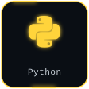</a>

<a href="https://pandas.pydata.org" title="pandas · tratamento de dados">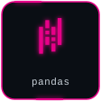</a>
<a href="https://www.microsoft.com/power-platform/products/power-bi" title="Power BI · dashboards e indicadores">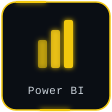</a>

<a href="https://plotly.com/python/" title="Plotly · visualização interativa">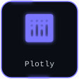</a>
<a href="https://jupyter.org" title="Jupyter · exploração de dados">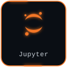</a>

<code>// IA, automação &amp; ferramentas</code> 
<a href="https://ollama.com" title="LLMs locais · IA aplicada com validação">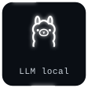</a>
<a href="https://www.anthropic.com" title="Claude · agentes e automação com IA">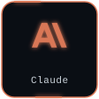</a>

<a href="https://git-scm.com" title="Git">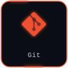</a>

<code>// desenvolvimento &amp; infra</code> 
<a href="https://www.typescriptlang.org" title="TypeScript">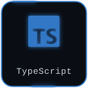</a>
<a href="https://react.dev" title="React">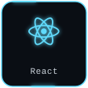</a>
<a href="https://nextjs.org" title="Next.js">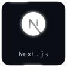</a>
<a href="https://nodejs.org" title="Node.js">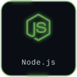</a>

<a href="https://www.docker.com" title="Docker · ambientes reproduzíveis">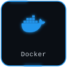</a>
<a href="https://github.com/features/actions" title="GitHub Actions · CI/CD">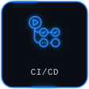</a>

  

passe o mouse sobre cada cartão

<a href="#" title="Antes do dashboard bonito vêm a origem, as regras e os testes do dado."></a>
<a href="#" title="Se a tarefa se repete toda semana, ela vira script, agenda ou app."></a>
<a href="#" title="Modelos de linguagem ajudam, mas toda saída passa por validação."></a>
<a href="#" title="Código que outra pessoa consegue rodar e manter sem perguntar."></a>

  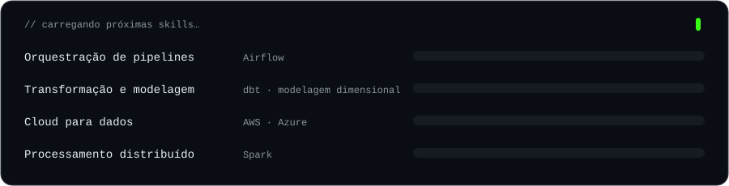

  

